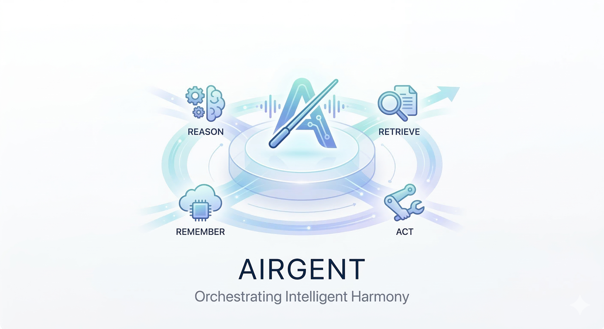

# Airgent



A local-first agent base system, powered by the [pi](https://pi.dev) agent kernel. It exposes the same runtime through:

- a CLI
- a TUI
- an HTTP API
- a WebUI

The agent brain — model routing, file/shell tools, skills, MCP, conversation compaction — is [pi](https://github.com/earendil-works/pi) (`@earendil-works/pi-coding-agent`), spawned as an RPC subprocess per session. Airgent keeps short-term transcripts and long-term memory in a local SQLite-backed store, persists pi conversations locally, and stays fully local-first.

When Airgent starts inside a project directory, that directory becomes the active workspace. Project-local skills are loaded from `.agents/skills` (discovered natively by pi).

## Stack

- Python 3.11+ / `uv` for environment and command management
- FastAPI for API and static WebUI hosting
- Typer for CLI, prompt-toolkit for the TUI
- pi (`@earendil-works/pi-coding-agent`) as the agent kernel
- SQLite for transcripts and long-term memory

## Quick Start

```bash
# 1. install the pi kernel (once)
curl -fsSL https://pi.dev/install.sh | sh
# or: npm install -g --ignore-scripts @earendil-works/pi-coding-agent

# 2. configure and run
uv sync
export OPENAI_API_KEY=your_key
export OPENAI_BASE_URL=https://xxx.example.com/v1
uv run airgent serve --reload
```

Then open `http://127.0.0.1:10304`.

## Global Install

You do not need to create a virtual environment manually for normal use.

```bash
sh scripts/install.sh
```

Then you can run:

```bash
airgent tui
airgent serve
```

## CLI

One-shot:

```bash
uv run airgent chat "给我一个今天的工作计划"
```

Interactive:

```bash
uv run airgent chat
```

TUI:

```bash
airgent tui
```

Inside the TUI:

- `Enter` sends the current prompt
- `/` opens the command palette
- `/resume` searches and restores a previous session
- `Ctrl-O` toggles full execution details for thinking/tool activity

Session inspection:

```bash
airgent sessions list
airgent sessions show <session-id>
```

Memory inspection:

```bash
airgent memory list
airgent memory search "uv python"
airgent memory add "The user prefers uv for Python envs" --tags python,tooling
airgent memory blocks                                  # core memory blocks
airgent memory set-block persona "Concise and blunt"
```

## API

Run the agent:

```bash
curl -X POST http://127.0.0.1:10304/api/v1/agent/run \
  -H 'Content-Type: application/json' \
  -d '{
    "input": "总结一下 Airgent 这个项目该怎么设计"
  }'
```

List sessions:

```bash
curl http://127.0.0.1:10304/api/v1/sessions
```

List memory:

```bash
curl http://127.0.0.1:10304/api/v1/memories
```

## Optional Capabilities

Airgent is, by default, the simplest pi-agent wrapper. Every modern-agent
capability below is opt-in via environment variables — flip one on when you
need it (`airgent status` shows what is enabled; `GET /api/v1/features` over HTTP):

| Feature | Env | What it does |
|---------|-----|--------------|
| Sandbox | `AIRGENT_SANDBOX=seatbelt\|docker` | Runs the pi kernel inside a macOS Seatbelt profile or a Docker container; network denied by default. See [docs/sandbox.md](docs/sandbox.md). |
| Skill registry | `AIRGENT_SKILLS_REGISTRY=1` | Per-skill enable/disable (`airgent skills list/enable/disable`), on top of pi's native `.agents/skills` discovery. |
| MCP servers | `AIRGENT_MCP=1` | Bridges external MCP servers (Claude-Desktop-compatible `~/.airgent/mcp.json`) into pi tools as `mcp__<server>__<tool>`. |
| Sub-agents | `AIRGENT_SUBAGENTS=1` | Adds a `spawn_subagent` tool: the root agent delegates self-contained subtasks to fresh headless pi processes, with a depth cap. |
| Guardrails | `AIRGENT_GUARDRAILS=1` | Policy-driven tool-call blocking (denied commands/paths/tools) via `~/.airgent/guardrails.json`. |
| Hooks | `AIRGENT_HOOKS=1` | `before_run` / `after_run` shell hooks fed JSON on stdin (`~/.airgent/hooks.json`); `before_run` can veto a run (exit 2). |
| Memory upgrades | see below | kinds/importance, time decay, dedup, core memory blocks, automatic fact extraction. |
| Tracing | `AIRGENT_TRACING=1` | Persists per-run trace events (`turn_start`/`turn_end`/`turn_error`) to SQLite for observability. |

Memory upgrades (inspired by mem0 / Letta / Zep):

- `AIRGENT_MEMORY_DEDUP=1` — near-duplicate memories are merged instead of stored twice.
- `AIRGENT_MEMORY_DECAY_DAYS=N` — importance halves every N days without access; ranked search downgrades stale rows.
- `AIRGENT_MEMORY_CORE_BLOCKS=1` — Letta-style always-in-context blocks (`airgent memory set-block persona "..."`), injected as `<core-memory>` each turn.
- `AIRGENT_MEMORY_AUTO_EXTRACT=1` — mines durable facts ("记住…", "I prefer…", "我正在开发…") from every user message into typed memories.
- Every memory carries a `kind` (`fact|preference|profile|project|event`) and an `importance` weight used by search (`airgent memory add --kind preference --importance 0.9`).

## Notes

- Local data defaults to `~/.airgent/`; pi state (sessions, model config, extensions) lives under `~/.airgent/pi/` and never touches your own `~/.pi`.
- Project-local skills default to `./.agents/skills` (standard [Agent Skills](https://agentskills.io) layout, discovered natively by pi).
- `.env` is loaded automatically. Supported keys:

```env
OPENAI_API_KEY=sk-...
OPENAI_BASE_URL=https://your-proxy.example.com/v1
OPENAI_API_MODE=chat_completions
AIRGENT_MODEL=anthropic/claude-sonnet-4.5
AIRGENT_PI_BIN=pi
# Optional capabilities (all default to off — see .env.example)
#AIRGENT_SANDBOX=seatbelt
#AIRGENT_SKILLS_REGISTRY=1
#AIRGENT_MCP=1
#AIRGENT_SUBAGENTS=1
#AIRGENT_GUARDRAILS=1
#AIRGENT_HOOKS=1
#AIRGENT_MEMORY_DEDUP=1
#AIRGENT_TRACING=1
```

- When `OPENAI_BASE_URL` is set, Airgent configures pi with an `airgent` provider over that proxy; namespaced model IDs such as `anthropic/claude-sonnet-4.5` are forwarded to the proxy as-is.
- Without `OPENAI_BASE_URL`, pi resolves models from its built-in catalog (set provider keys like `ANTHROPIC_API_KEY` in the environment).
- Each Airgent session maps to one pi conversation (resumable); transcripts are mirrored into SQLite for listing/search.
- Long-term memory tools (`search_memory`, `remember_note`) are provided to the model by the bundled `airgent-memory` pi extension, backed by the same SQLite store.
- Root agent tools are pi's built-ins (read/write/edit/bash/grep/…), skills, plus the memory extension.

## Architecture

See [docs/ARCHITECTURE.md](docs/ARCHITECTURE.md).

## license

MIT
